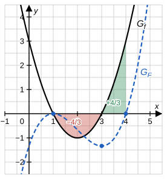

# Musterlösung: Analysis-Stegreifaufgabe – Bayern 13. Klasse

## Integrationsregeln, Integralfunktion und Stammfunktionen

In allen Teilaufgaben gilt $C \in \mathbb{R}$.

---

## Aufgabe 1 – Stammfunktionen (6 BE)

**a)** [2 BE]

Nenner: $u(x) = x^2 - x + 4 \Rightarrow u'(x) = 2x - 1$. Der Zähler ist das Dreifache davon: $6x - 3 = 3\cdot(2x-1)$.

$$\int \frac{6x-3}{x^2-x+4}\,dx = 3\int \frac{2x-1}{x^2-x+4}\,dx = 3\ln\left(x^2-x+4\right) + C$$

Der Betrag kann entfallen: Die Diskriminante von $x^2 - x + 4$ ist $(-1)^2 - 4\cdot 1\cdot 4 = -15 < 0$, der Nenner hat keine Nullstelle und ist (nach oben geöffnete Parabel) stets positiv.

**b)** [2 BE]

Exponent: $u(x) = 2 - x^3 \Rightarrow u'(x) = -3x^2$. Es fehlt der Faktor $-3$:

$$\int x^2 \cdot e^{2-x^3}\,dx = -\frac{1}{3}\int (-3x^2)\cdot e^{2-x^3}\,dx = -\frac{1}{3}\,e^{2-x^3} + C$$

*Probe:* $\left(-\frac{1}{3}\,e^{2-x^3}\right)' = -\frac{1}{3}\cdot e^{2-x^3}\cdot(-3x^2) = x^2\, e^{2-x^3}$ ✓

**c)** [2 BE]

Lineare Verkettung: $\frac{4}{(2x-1)^3} = 4\,(2x-1)^{-3}$ mit innerer Funktion $2x - 1$ (innere Ableitung $2$).

$$\int 4\,(2x-1)^{-3}\,dx = 4\cdot\frac{1}{2}\cdot\frac{(2x-1)^{-2}}{-2} + C = -(2x-1)^{-2} + C = -\frac{1}{(2x-1)^2} + C$$

*Probe:* $\left(-(2x-1)^{-2}\right)' = 2\,(2x-1)^{-3}\cdot 2 = \frac{4}{(2x-1)^3}$ ✓

---

## Aufgabe 2 – Integralfunktion (10 BE)

Nach dem Hauptsatz der Differential- und Integralrechnung gilt $F'(x) = f(x)$. Die Abbildung zeigt zusätzlich den Graphen $G_F$ (blau gestrichelt) und die Flächenstücke aus d).

**a)** [2 BE]

- An der Stelle $x = 1$ hat $f$ eine Nullstelle mit **Vorzeichenwechsel von $+$ nach $-$** (links von 1 liegt $G_f$ oberhalb, rechts unterhalb der $x$-Achse). Wegen $F' = f$ ist $F$ links von 1 streng monoton steigend und rechts davon streng monoton fallend $\Rightarrow$ lokales **Maximum** bei $x = 1$.
- An der Stelle $x = 3$ hat $f$ eine Nullstelle mit **Vorzeichenwechsel von $-$ nach $+$** $\Rightarrow$ $F$ wechselt von fallend zu steigend $\Rightarrow$ lokales **Minimum** bei $x = 3$.

**b)** [3 BE]

$F(1) = \int_1^1 f(t)\,dt = 0$ (obere Grenze = untere Grenze).

Begründung für genau zwei Nullstellen:

- **$x < 1$:** $F$ ist dort streng monoton steigend und erreicht erst bei $x = 1$ den Wert $0$. Also gilt $F(x) < 0$ für $x < 1$ – keine Nullstelle.
- **$x = 1$:** Nullstelle. Da hier zugleich ein Hochpunkt liegt, **berührt** $G_F$ die $x$-Achse.
- **$1 < x \leq 3$:** $F$ fällt streng monoton, also $F(x) < 0$ – keine Nullstelle. Anschaulich: Zwischen 1 und $x$ liegt nur Fläche **unterhalb** der $x$-Achse.
- **$x > 3$:** $F$ steigt streng monoton. Da $f(x)$ für $x > 3$ positiv ist und beliebig groß wird, kommt nach rechts immer mehr Fläche **oberhalb** der $x$-Achse hinzu. Irgendwann ist sie genauso groß wie die Fläche zwischen 1 und 3 unterhalb der $x$-Achse – dort hat $F$ genau **eine** weitere Nullstelle (wegen der strengen Monotonie keine zweite).

Insgesamt hat $F$ also genau zwei Nullstellen.

**c)** [3 BE]

Eine Stammfunktion von $f(t) = t^2 - 4t + 3$ ist $\frac{1}{3}t^3 - 2t^2 + 3t$:

$$F(x) = \left[\frac{1}{3}t^3 - 2t^2 + 3t\right]_1^x = \frac{1}{3}x^3 - 2x^2 + 3x - \left(\frac{1}{3} - 2 + 3\right) = \frac{1}{3}x^3 - 2x^2 + 3x - \frac{4}{3}$$

Ausmultiplizieren der angegebenen Form:

$$\frac{1}{3}(x-1)^2(x-4) = \frac{1}{3}\left(x^2 - 2x + 1\right)(x-4) = \frac{1}{3}\left(x^3 - 4x^2 - 2x^2 + 8x + x - 4\right) = \frac{1}{3}\left(x^3 - 6x^2 + 9x - 4\right)$$

$$= \frac{1}{3}x^3 - 2x^2 + 3x - \frac{4}{3} \qquad ✓$$

Nullstellen: $x_1 = 1$ (doppelte Nullstelle – passt zum Berührpunkt aus b)) und $x_2 = 4$.

**d)** [2 BE]

Wegen c) gilt $F(4) = \int_1^4 f(x)\,dx = 0$ und $F(3) = \frac{1}{3}\cdot 2^2\cdot(-1) = -\frac{4}{3}$. Mit der Intervalladditivität folgt:

$$\int_1^3 f(x)\,dx + \int_3^4 f(x)\,dx = \int_1^4 f(x)\,dx = 0 \quad\Rightarrow\quad \int_3^4 f(x)\,dx = -\int_1^3 f(x)\,dx = -F(3) = \frac{4}{3}$$

Geometrisch: Das Flächenstück zwischen 3 und 4 oberhalb der $x$-Achse (grün) ist genauso groß wie das Flächenstück zwischen 1 und 3 unterhalb der $x$-Achse (rot), nämlich $\frac{4}{3}$ FE – die Flächenbilanz von 1 bis 4 ist null.

---

## Aufgabe 3 – Eine besondere Stammfunktion (4 BE)

**a)** [2 BE]

$g(x) = 1 - x^{-2}$, also

$$G(x) = x - \frac{x^{-1}}{-1} + c = x + \frac{1}{x} + c, \quad c \in \mathbb{R}.$$

Punktprobe mit $P(1 \mid 0)$: $G(1) = 1 + 1 + c = 0 \Rightarrow c = -2$. Damit:

$$G(x) = x + \frac{1}{x} - 2 = \frac{x^2 + 1 - 2x}{x} = \frac{(x-1)^2}{x}$$

**b)** [2 BE]

Für jede Stammfunktion $H$ von $g$ gilt $H'(x) = g(x) = \dfrac{x^2-1}{x^2} = \dfrac{(x-1)(x+1)}{x^2}$. Für $x > 0$ sind $x + 1$ und $x^2$ positiv, das Vorzeichen bestimmt also allein $x - 1$:

- $0 < x < 1$: $g(x) < 0$, $H$ fällt;
- $x > 1$: $g(x) > 0$, $H$ steigt.

$g$ hat bei $x = 1$ eine Nullstelle mit Vorzeichenwechsel von $-$ nach $+$, also hat **jede** Stammfunktion dort ein lokales Minimum. (Alle Stammfunktionen unterscheiden sich nur um eine Konstante und haben daher dieselben Extremstellen.)

Wertemenge von $G$: Wegen $(x-1)^2 \geq 0$ und $x > 0$ ist $G(x) \geq 0$, und $G(1) = 0$ ist der kleinste Wert. Für $x \to 0^+$ und für $x \to \infty$ gilt $G(x) \to \infty$. Da $G$ stetig ist, folgt

$$W_G = [0;\, \infty[.$$

(Der Graph von $G$ berührt die $x$-Achse im Punkt $P(1 \mid 0)$.)

---

## Bewertungsübersicht

| Aufgabe | Teilaufgabe | Inhalt | BE |
|---------|-------------|--------|----|
| 1 | a) | $3\ln(x^2-x+4) + C$ | 2 |
| 1 | b) | $-\frac{1}{3}e^{2-x^3} + C$ | 2 |
| 1 | c) | $-\frac{1}{(2x-1)^2} + C$ | 2 |
| 2 | a) | Max. bei 1, Min. bei 3 (VZW von $f$) | 2 |
| 2 | b) | $F(1) = 0$; Begründung genau zwei Nullstellen | 3 |
| 2 | c) | Term von $F$, Faktorisierung, Nullstellen 1 und 4 | 3 |
| 2 | d) | $\int_3^4 f(x)\,dx = \frac{4}{3}$ | 2 |
| 3 | a) | $G(x) = x + \frac{1}{x} - 2 = \frac{(x-1)^2}{x}$ | 2 |
| 3 | b) | VZW von $g$; $W_G = [0;\,\infty[$ | 2 |
| **Gesamt** | | | **20** |
