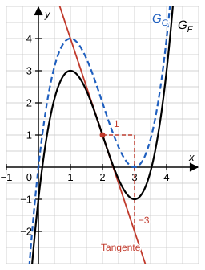

# Musterlösung: Analysis-Stegreifaufgabe – Bayern 13. Klasse

## Hauptsatz der Differential- und Integralrechnung

---

## Aufgabe 1 – Den Graphen einer Stammfunktion auswerten (8 BE)

Aus der Abbildung liest man ab: $F(0) = -1$, $F(1) = 3$ (Hochpunkt), $F(2) = 1$, $F(3) = -1$ (Tiefpunkt), $F(4) = 3$.

Die folgende Abbildung zeigt zusätzlich die Tangente aus c) (rot) und den Graphen von $G$ aus d) (blau gestrichelt).

**a)** [2 BE]

Nach dem Hauptsatz gilt $\int_a^b f(x)\,dx = F(b) - F(a)$ für jede Stammfunktion $F$ von $f$:

$$\int_0^4 f(x)\,dx = F(4) - F(0) = 3 - (-1) = 4$$

**b)** [2 BE]

Wegen $f = F'$ sind die Nullstellen von $f$ genau die Stellen mit waagrechter Tangente an $G_F$, hier die Extremstellen: $x_1 = 1$ und $x_2 = 3$.

$$\int_1^3 f(x)\,dx = F(3) - F(1) = -1 - 3 = -4$$

Deutung: Auf $]1;\,3[$ fällt $F$, also ist dort $f = F' < 0$ – der Graph von $f$ verläuft zwischen 1 und 3 **unterhalb** der $x$-Achse. Er schließt mit der $x$-Achse ein Flächenstück mit dem Inhalt $4$ FE ein; das negative Vorzeichen kommt von der Lage unterhalb der $x$-Achse.

**c)** [2 BE]

$f(2) = F'(2)$ ist die **Steigung der Tangente** an $G_F$ im Punkt $(2 \mid 1)$. Man zeichnet die Tangente ein und liest mit einem Steigungsdreieck ab: $1$ nach rechts, etwa $3$ nach unten.

$$f(2) \approx \frac{-3}{1} = -3$$

(Werte zwischen etwa $-3{,}5$ und $-2{,}5$ sind als Ablesung zu akzeptieren. Der hier nicht angegebene Funktionsterm $F(x) = x^3 - 6x^2 + 9x - 1$ liefert exakt $f(2) = -3$. Bei $x = 2$ liegt der Wendepunkt von $G_F$, dort fällt $G_F$ am stärksten.)

**d)** [2 BE]

Alle Stammfunktionen von $f$ unterscheiden sich nur um eine Konstante: $G(x) = F(x) + c$.

$$G(3) = F(3) + c = -1 + c = 0 \quad\Rightarrow\quad c = 1$$

$$G(1) = F(1) + 1 = 3 + 1 = 4$$

*Alternativ:* $G(1) = G(3) - \int_1^3 f(x)\,dx = 0 - (-4) = 4$.

Der Graph von $G$ ist der um 1 nach oben verschobene Graph von $F$.

---

## Aufgabe 2 – Bestimmte Integrale (7 BE)

**a)** [2 BE]

Nenner: $u(x) = e^{2x} + 3 \Rightarrow u'(x) = 2e^{2x}$. Es fehlt der Faktor 2:

$$\int_0^{\ln 2} \frac{e^{2x}}{e^{2x}+3}\,dx = \frac{1}{2}\int_0^{\ln 2} \frac{2e^{2x}}{e^{2x}+3}\,dx = \frac{1}{2}\Big[\ln\left(e^{2x}+3\right)\Big]_0^{\ln 2}$$

Mit $e^{2\ln 2} = \left(e^{\ln 2}\right)^2 = 4$ und $e^0 = 1$:

$$= \frac{1}{2}\big(\ln(4+3) - \ln(1+3)\big) = \frac{1}{2}(\ln 7 - \ln 4) = \frac{1}{2}\ln\frac{7}{4} \;(\approx 0{,}28)$$

**b)** [2 BE]

Für $h(x) = x^3 \cdot e^{x^2}$ gilt

$$h(-x) = (-x)^3 \cdot e^{(-x)^2} = -x^3 \cdot e^{x^2} = -h(x).$$

Der Graph von $h$ ist also **punktsymmetrisch zum Ursprung**. Das Integrationsintervall $[-2;\,2]$ liegt symmetrisch zu 0, daher sind die Flächenstücke links (unterhalb der $x$-Achse) und rechts (oberhalb der $x$-Achse) gleich groß und heben sich in der Flächenbilanz auf:

$$\int_{-2}^{2} x^3\cdot e^{x^2}\,dx = 0$$

**c)** [3 BE]

Lineare Verkettung: Eine Stammfunktion von $\frac{1}{2x-1}$ ist $\frac{1}{2}\ln\lvert 2x-1\rvert$. Für $x \geq 1$ ist $2x - 1 > 0$, der Betrag entfällt.

$$\int_1^k \frac{1}{2x-1}\,dx = \left[\frac{1}{2}\ln(2x-1)\right]_1^k = \frac{1}{2}\ln(2k-1) - \frac{1}{2}\underbrace{\ln 1}_{=0} = \frac{1}{2}\ln(2k-1)$$

$$\frac{1}{2}\ln(2k-1) = \ln 3 \;\Leftrightarrow\; \ln(2k-1) = 2\ln 3 = \ln 9 \;\Leftrightarrow\; 2k - 1 = 9 \;\Leftrightarrow\; k = 5$$

$k = 5 > 1$ ✓

---

## Aufgabe 3 – Fehler finden (5 BE)

**(1)** [2 BE]

Die Stammfunktion ist richtig, aber beim Einsetzen der unteren Grenze ist ein **Vorzeichenfehler** passiert: $-(-2)^2 = -4$, nicht $+4$.

$$F(-2) = \frac{1}{3}\cdot(-2)^3 - (-2)^2 = -\frac{8}{3} - 4 = -\frac{20}{3}$$

Richtig:

$$\int_{-2}^{1} \left(x^2 - 2x\right)dx = \left(\frac{1}{3} - 1\right) - \left(-\frac{8}{3} - 4\right) = -\frac{2}{3} + \frac{20}{3} = \frac{18}{3} = 6$$

*Plausibilitätscheck:* $x^2 - 2x = x(x-2)$ ist auf $[-2;\,0]$ positiv ($\int_{-2}^0 = \frac{20}{3}$) und auf $[0;\,1]$ negativ ($\int_0^1 = -\frac{2}{3}$). Die Bilanz $\frac{20}{3} - \frac{2}{3} = 6$ ist positiv – das Ergebnis $-2$ konnte also nicht stimmen.

**(2)** [3 BE]

- **Fehler:** Die Stammfunktion ist falsch. *Probe:* $\big(2\sin(2x)\big)' = 2\cos(2x)\cdot 2 = 4\cos(2x) \neq \cos(2x)$. Bei der linearen Verkettung muss man durch die innere Ableitung $2$ **teilen**, nicht mit ihr multiplizieren.
- **Berichtigung:**

$$\int_0^{\frac{\pi}{2}} \cos(2x)\,dx = \left[\frac{1}{2}\sin(2x)\right]_0^{\frac{\pi}{2}} = \frac{1}{2}\sin(\pi) - \frac{1}{2}\sin(0) = 0 - 0 = 0$$

- **Das Ergebnis $0$ ist trotzdem richtig – aber nur zufällig:** Jede Funktion der Form $c\cdot\sin(2x)$ hat an beiden Grenzen den Wert 0 (wegen $\sin(\pi) = \sin(0) = 0$), deshalb fällt der falsche Faktor nicht auf. Geometrisch: $\cos(2x)$ ist auf $\left[0;\,\frac{\pi}{4}\right]$ positiv und auf $\left[\frac{\pi}{4};\,\frac{\pi}{2}\right]$ negativ, beide Flächenstücke haben den Inhalt $\frac{1}{2}$ FE und heben sich auf. Die Rechnung ist trotz richtigem Ergebnis **nicht korrekt** und wird nicht voll gewertet.

---

## Bewertungsübersicht

| Aufgabe | Teilaufgabe | Inhalt | BE |
|---------|-------------|--------|----|
| 1 | a) | $F(4) - F(0) = 4$ | 2 |
| 1 | b) | Nullstellen 1 und 3; $\int_1^3 f(x)\,dx = -4$; Deutung | 2 |
| 1 | c) | Tangente, Steigungsdreieck, $f(2) \approx -3$ | 2 |
| 1 | d) | $G = F + 1$, $G(1) = 4$ | 2 |
| 2 | a) | $\frac{1}{2}\ln\frac{7}{4}$ | 2 |
| 2 | b) | Punktsymmetrie, symmetrisches Intervall | 2 |
| 2 | c) | $k = 5$ | 3 |
| 3 | (1) | Vorzeichenfehler, richtiger Wert 6 | 2 |
| 3 | (2) | Stammfunktion falsch, Berichtigung, Begründung „zufällig richtig" | 3 |
| **Gesamt** | | | **20** |
