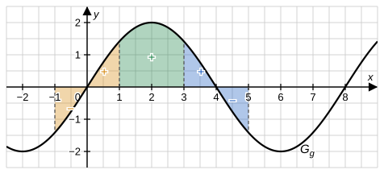

# Musterlösung: Analysis-Stegreifaufgabe – Bayern 13. Klasse

## Das bestimmte Integral – von der Streifensumme zur Integralfunktion

---

## Aufgabe 1 – Ober- und Untersumme (4 BE)

**a)** [3 BE]

Streifenbreite $\Delta x = \frac{2-0}{4} = 0{,}5$. Funktionswerte an den Streifengrenzen:

| $x$ | $0$ | $0{,}5$ | $1$ | $1{,}5$ | $2$ |
|-----|-----|---------|-----|---------|-----|
| $f(x) = 4 - x^2$ | $4$ | $3{,}75$ | $3$ | $1{,}75$ | $0$ |

Da $f$ auf $[0;\,2]$ streng monoton **fällt**, liegt das Maximum jedes Streifens am **linken** Rand, das Minimum am **rechten** Rand.

$$O_4 = 0{,}5\cdot(4 + 3{,}75 + 3 + 1{,}75) = 0{,}5\cdot 12{,}5 = 6{,}25$$

$$U_4 = 0{,}5\cdot(3{,}75 + 3 + 1{,}75 + 0) = 0{,}5\cdot 8{,}5 = 4{,}25$$

Abschätzung:

$$4{,}25 < \int_0^2 f(x)\,dx < 6{,}25$$

**b)** [1 BE]

$$\int_0^2 \left(4 - x^2\right)dx = \left[4x - \frac{1}{3}x^3\right]_0^2 = 8 - \frac{8}{3} = \frac{16}{3} \approx 5{,}33$$

Der Wert liegt wie erwartet zwischen $U_4$ und $O_4$.

---

## Aufgabe 2 – Integralfunktionen mit Parameter (7 BE)

Eine Stammfunktion von $f(t) = 2t - 4$ ist $t^2 - 4t$.

**a)** [2 BE]

$$F_0(x) = \Big[t^2 - 4t\Big]_0^x = x^2 - 4x - 0 = x(x-4)$$

Nullstellen: $x_1 = 0$ und $x_2 = 4$.

**b)** [3 BE]

$$F_a(x) = \Big[t^2 - 4t\Big]_a^x = x^2 - 4x - \left(a^2 - 4a\right) = \left(x^2 - a^2\right) - 4(x - a)$$

$$= (x-a)(x+a) - 4(x-a) = (x-a)(x+a-4) \qquad ✓$$

Nullstellen von $F_a$: $x_1 = a$ und $x_2 = 4 - a$. Es gibt genau dann nur **eine** Nullstelle, wenn beide zusammenfallen:

$$a = 4 - a \;\Leftrightarrow\; a = 2$$

Dann gilt $F_2(x) = (x-2)^2$ mit der (doppelten) Nullstelle $x = 2$.

**c)** [2 BE]

Wegen $G'(x) = 2x - 4 = f(x)$ ist $G$ eine Stammfunktion von $f$.

**Jede** Integralfunktion $F_a$ hat an ihrer unteren Grenze eine Nullstelle, denn $F_a(a) = \int_a^a f(t)\,dt = 0$.

$G$ hat dagegen **keine** Nullstelle: Quadratische Ergänzung liefert

$$G(x) = x^2 - 4x + 5 = (x-2)^2 + 1 \geq 1 > 0$$

(bzw. Diskriminante $(-4)^2 - 4\cdot 1\cdot 5 = -4 < 0$). Also kann $G$ für kein $a$ mit $F_a$ übereinstimmen.

*Merke:* Jede Integralfunktion ist eine Stammfunktion, aber nicht jede Stammfunktion ist eine Integralfunktion.

---

## Aufgabe 3 – Flächenbilanz am Sinus-Graphen (5 BE)

**a)** [2 BE]

Man zerlegt das Intervall $[-1;\,5]$ in drei Teile:

- **$[-1;\,1]$ (orange):** $G_g$ ist punktsymmetrisch zum Ursprung. Das Flächenstück von $-1$ bis $0$ unterhalb der $x$-Achse ist genauso groß wie das von $0$ bis $1$ oberhalb – Bilanz $0$.
- **$[3;\,5]$ (blau):** $G_g$ ist auch punktsymmetrisch zur Nullstelle $(4 \mid 0)$. Die Flächenstücke von $3$ bis $4$ (oberhalb) und von $4$ bis $5$ (unterhalb) heben sich auf – Bilanz $0$.
- **$[1;\,3]$ (grün):** Hier verläuft $G_g$ vollständig **oberhalb** der $x$-Achse.

Insgesamt bleibt nur das grüne Flächenstück übrig, das Integral ist also **positiv**.

**b)** [3 BE]

Stammfunktion mit linearer Verkettung (innere Ableitung $\frac{\pi}{4}$):

$$\int 2\sin\left(\tfrac{\pi}{4}x\right)dx = 2\cdot\frac{1}{\frac{\pi}{4}}\cdot\left(-\cos\left(\tfrac{\pi}{4}x\right)\right) + C = -\frac{8}{\pi}\cos\left(\tfrac{\pi}{4}x\right) + C$$

*Probe:* $\left(-\frac{8}{\pi}\cos\left(\tfrac{\pi}{4}x\right)\right)' = -\frac{8}{\pi}\cdot\left(-\sin\left(\tfrac{\pi}{4}x\right)\right)\cdot\frac{\pi}{4} = 2\sin\left(\tfrac{\pi}{4}x\right)$ ✓

$$\int_{-1}^{5} g(x)\,dx = \left[-\frac{8}{\pi}\cos\left(\tfrac{\pi}{4}x\right)\right]_{-1}^{5} = -\frac{8}{\pi}\left(\cos\left(\tfrac{5\pi}{4}\right) - \cos\left(-\tfrac{\pi}{4}\right)\right)$$

Mit $\cos\left(\frac{5\pi}{4}\right) = -\frac{\sqrt{2}}{2}$ und $\cos\left(-\frac{\pi}{4}\right) = \cos\left(\frac{\pi}{4}\right) = \frac{\sqrt{2}}{2}$:

$$= -\frac{8}{\pi}\left(-\frac{\sqrt{2}}{2} - \frac{\sqrt{2}}{2}\right) = -\frac{8}{\pi}\cdot\left(-\sqrt{2}\right) = \frac{8\sqrt{2}}{\pi} \approx 3{,}60$$

Das Ergebnis ist positiv – passend zu a). (Es stimmt mit $\int_1^3 g(x)\,dx$ überein, da sich die übrigen Teile aufheben.)

---

## Aufgabe 4 – Zusammengesetzte Funktion (4 BE)

**Lösung** [4 BE]

$h$ ist stetig ($2\cdot 1 = 2 = 3 - 1$). Der Graph steigt von $(0 \mid 0)$ bis $(1 \mid 2)$ und fällt dann als Gerade, die bei $x = 3$ die $x$-Achse schneidet.

**Fall $0 < t \leq 1$:**

$$\int_0^t 2x\,dx = t^2 \leq 1 < 2 \quad\Rightarrow\quad \text{keine Lösung.}$$

**Fall $t > 1$:** Zerlegung an der Stelle 1:

$$\int_0^t h(x)\,dx = \int_0^1 2x\,dx + \int_1^t (3-x)\,dx = 1 + \left[3x - \frac{1}{2}x^2\right]_1^t = 1 + 3t - \frac{1}{2}t^2 - \left(3 - \frac{1}{2}\right)$$

$$= -\frac{1}{2}t^2 + 3t - \frac{3}{2}$$

$$-\frac{1}{2}t^2 + 3t - \frac{3}{2} = 2 \;\Leftrightarrow\; t^2 - 6t + 7 = 0 \;\Leftrightarrow\; t_{1,2} = \frac{6 \pm \sqrt{36 - 28}}{2} = 3 \pm \sqrt{2}$$

Beide Werte erfüllen $t > 1$ (denn $3 - \sqrt{2} \approx 1{,}59$ und $3 + \sqrt{2} \approx 4{,}41$):

$$t_1 = 3 - \sqrt{2}, \qquad t_2 = 3 + \sqrt{2}$$

*Deutung:* Bis $t = 3$ liegt der Graph oberhalb der $x$-Achse, das Integral wächst bis zum Maximalwert $3$. Danach liegt der Graph unterhalb der $x$-Achse, das Integral nimmt wieder ab und erreicht den Wert $2$ ein zweites Mal.

---

## Bewertungsübersicht

| Aufgabe | Teilaufgabe | Inhalt | BE |
|---------|-------------|--------|----|
| 1 | a) | $O_4 = 6{,}25$, $U_4 = 4{,}25$, Abschätzung | 3 |
| 1 | b) | $\frac{16}{3}$ | 1 |
| 2 | a) | $F_0(x) = x^2 - 4x$; Nullstellen 0 und 4 | 2 |
| 2 | b) | Nachweis der Faktorisierung; $a = 2$ | 3 |
| 2 | c) | $F_a(a) = 0$, aber $G(x) \geq 1$ | 2 |
| 3 | a) | Symmetrieargument, Integral positiv | 2 |
| 3 | b) | $\frac{8\sqrt{2}}{\pi}$ | 3 |
| 4 | – | Fallunterscheidung, $t = 3 \pm \sqrt{2}$ | 4 |
| **Gesamt** | | | **20** |
