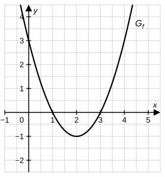

# Analysis-Stegreifaufgabe – Bayern 13. Klasse

## Integrationsregeln, Integralfunktion und Stammfunktionen

**Bearbeitungszeit:** 20 Minuten  
**Hilfsmittel:** keine  
**Gesamtpunktzahl:** 20 BE  
**Datum:** ..................  **Name:** ..................

---

> 📝 **Tipps von eurer Lehrkraft:**
> - Lest euch erst alle Aufgaben kurz durch – die Zeit ist knapp, also fangt mit dem an, was ihr sicher könnt.
> - Bei Aufgabe 1: Sucht im Integranden die **innere Ableitung** bzw. die **Ableitung des Nenners**. Macht die Probe durch Ableiten!
> - Bei Aufgabe 2 gilt der Hauptsatz: $F'(x) = f(x)$. Argumentiert mit dem **Vorzeichen von $f$** – und schreibt eure Begründungen in ganzen Sätzen auf.
> - Ergebnisse ohne Rechenweg bzw. ohne Begründung werden nicht gewertet!

---

## Aufgabe 1 – Stammfunktionen (6 BE)

Bestimme jeweils das unbestimmte Integral ($C \in \mathbb{R}$).

**a)** $\displaystyle\int \frac{6x-3}{x^2-x+4}\,dx$ [2 BE]

**b)** $\displaystyle\int x^2 \cdot e^{2-x^3}\,dx$ [2 BE]

**c)** $x \neq \frac{1}{2}$: $\displaystyle\int \frac{4}{(2x-1)^3}\,dx$ [2 BE]

---

## Aufgabe 2 – Integralfunktion (10 BE)

Die Abbildung zeigt den Graphen $G_f$ der in $\mathbb{R}$ definierten Funktion $f$ (eine nach oben geöffnete Parabel mit Scheitel $S(2 \mid -1)$). Betrachtet wird die in $\mathbb{R}$ definierte Integralfunktion

$$F\colon x \mapsto \int_1^x f(t)\,dt.$$

**a)** Begründe mithilfe der Abbildung, dass $F$ an der Stelle $x = 1$ ein lokales Maximum und an der Stelle $x = 3$ ein lokales Minimum besitzt. [2 BE]

**b)** Gib $F(1)$ an. Begründe **ohne Rechnung**, dass $F$ genau zwei Nullstellen besitzt. [3 BE]

**c)** Es gilt $f(x) = x^2 - 4x + 3$. Bestimme einen integralfreien Funktionsterm von $F$ und zeige, dass gilt: $F(x) = \frac{1}{3}(x-1)^2(x-4)$. Gib damit die beiden Nullstellen von $F$ an. [3 BE]

**d)** ⭐ Gib **ohne weitere Rechnung** den Wert des Integrals $\displaystyle\int_3^4 f(x)\,dx$ an und begründe deine Antwort. [2 BE]

---

## Aufgabe 3 – Eine besondere Stammfunktion (4 BE)

Gegeben ist die Funktion $g$ mit $g(x) = 1 - \dfrac{1}{x^2}$ und $x > 0$.

**a)** Bestimme die Stammfunktion $G$ von $g$, deren Graph durch den Punkt $P(1 \mid 0)$ verläuft, und zeige, dass gilt: $G(x) = \dfrac{(x-1)^2}{x}$. [2 BE]

**b)** ⭐ Begründe, dass **jede** Stammfunktion von $g$ an der Stelle $x = 1$ ein lokales Minimum besitzt, und gib die Wertemenge von $G$ an. [2 BE]

---

**Viel Erfolg! 🍀 Ihr schafft das – und denkt dran: Ableiten ist die beste Kontrolle :)**
