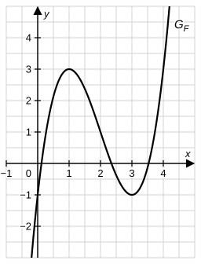

# Analysis-Stegreifaufgabe – Bayern 13. Klasse

## Hauptsatz der Differential- und Integralrechnung

**Bearbeitungszeit:** 20 Minuten  
**Hilfsmittel:** keine  
**Gesamtpunktzahl:** 20 BE  
**Datum:** ..................  **Name:** ..................

---

> 📝 **Tipps von eurer Lehrkraft:**
> - Aufgabe 1 ist kniffliger, als sie aussieht: Die Abbildung zeigt **nicht** $f$, sondern eine **Stammfunktion** von $f$! Überlegt euch genau, was ihr ablesen könnt.
> - Bei den bestimmten Integralen lohnt es sich, **vor** dem Rechnen auf Symmetrie zu achten – manchmal spart das die ganze Rechnung.
> - Bei Aufgabe 3 reicht es nicht, nur „falsch" zu schreiben: Benennt den Fehler und rechnet richtig vor.
> - Schreibt eure Lösungswege vollständig auf – Ergebnisse ohne Rechenweg werden nicht gewertet!

---

## Aufgabe 1 – Den Graphen einer Stammfunktion auswerten (8 BE)

Betrachtet werden die in $\mathbb{R}$ definierten Funktionen $f$ und $F$, wobei $F$ eine Stammfunktion von $f$ ist. Die Abbildung zeigt den Graphen $G_F$ von $F$; die Hoch- und Tiefpunkte sowie alle markanten Punkte liegen auf Gitterpunkten.

**a)** Bestimme mithilfe der Abbildung den Wert des Integrals $\displaystyle\int_0^4 f(x)\,dx$. [2 BE]

**b)** Gib alle Nullstellen von $f$ im Intervall $[0;\,4]$ an und bestimme den Wert des Integrals $\displaystyle\int_1^3 f(x)\,dx$. Deute das Vorzeichen des Ergebnisses geometrisch. [2 BE]

**c)** Bestimme mithilfe der Abbildung näherungsweise den Funktionswert $f(2)$. Veranschauliche dein Vorgehen in der Abbildung. [2 BE]

**d)** ⭐ $G$ ist diejenige Stammfunktion von $f$, für die $G(3) = 0$ gilt. Bestimme $G(1)$ und begründe dein Vorgehen. [2 BE]

---

## Aufgabe 2 – Bestimmte Integrale (7 BE)

**a)** Berechne den exakten Wert des Integrals $\displaystyle\int_0^{\ln 2} \frac{e^{2x}}{e^{2x}+3}\,dx$. [2 BE]

**b)** Begründe, **ohne eine Stammfunktion zu verwenden**, dass gilt: $\displaystyle\int_{-2}^{2} x^3 \cdot e^{x^2}\,dx = 0$. [2 BE]

**c)** ⭐ Bestimme $k > 1$ so, dass gilt: $\displaystyle\int_1^k \frac{1}{2x-1}\,dx = \ln 3$. [3 BE]

---

## Aufgabe 3 – Fehler finden (5 BE)

In zwei Hausaufgaben aus eurer Klasse wurden die folgenden Integrale berechnet. Finde ggf. die Fehler, benenne sie und berichtige die Rechnung.

**(1)** $\displaystyle\int_{-2}^{1} \left(x^2 - 2x\right)dx = \left[\frac{1}{3}x^3 - x^2\right]_{-2}^{1} = \left(\frac{1}{3} - 1\right) - \left(-\frac{8}{3} + 4\right) = -\frac{2}{3} - \frac{4}{3} = -2$ [2 BE]

**(2)** $\displaystyle\int_0^{\frac{\pi}{2}} \cos(2x)\,dx = \Big[2\sin(2x)\Big]_0^{\frac{\pi}{2}} = 2\sin(\pi) - 2\sin(0) = 0$ [3 BE]

> 💡 Bei (2) lohnt sich ein zweiter Blick: Ist das **Ergebnis** falsch – oder nur der **Weg**?

---

**Viel Erfolg! 🍀 Lasst euch von der Abbildung in Aufgabe 1 nicht aufs Glatteis führen :)**
