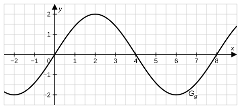

# Analysis-Stegreifaufgabe – Bayern 13. Klasse

## Das bestimmte Integral – von der Streifensumme zur Integralfunktion

**Bearbeitungszeit:** 20 Minuten  
**Hilfsmittel:** keine  
**Gesamtpunktzahl:** 20 BE  
**Datum:** ..................  **Name:** ..................

---

> 📝 **Tipps von eurer Lehrkraft:**
> - Macht euch bei Aufgabe 1 und 4 eine **kleine Skizze** – dann seht ihr sofort, welche Rechtecke bzw. Flächenstücke gemeint sind.
> - Bei Aufgabe 2 gilt: Stammfunktion und Integralfunktion sind **nicht** dasselbe – überlegt genau, was eine Integralfunktion auszeichnet.
> - In Aufgabe 3 hilft euch die Symmetrie des Sinus-Graphen enorm – erst schauen, dann rechnen!
> - Schreibt eure Lösungswege und Begründungen vollständig auf – Ergebnisse ohne Rechenweg werden nicht gewertet!

---

## Aufgabe 1 – Ober- und Untersumme (4 BE)

Gegeben ist die Funktion $f$ mit $f(x) = 4 - x^2$ im Intervall $[0;\,2]$.

**a)** Berechne die Obersumme $O_4$ und die Untersumme $U_4$ bei Unterteilung von $[0;\,2]$ in vier gleich breite Streifen und gib damit eine Abschätzung für $\displaystyle\int_0^2 f(x)\,dx$ an. [3 BE]

**b)** Berechne den exakten Wert von $\displaystyle\int_0^2 f(x)\,dx$. [1 BE]

---

## Aufgabe 2 – Integralfunktionen mit Parameter (7 BE)

Gegeben ist die Funktion $f$ mit $f(t) = 2t - 4$. Für $a \in \mathbb{R}$ betrachtet man die Integralfunktionen

$$F_a\colon x \mapsto \int_a^x f(t)\,dt.$$

**a)** Bestimme einen integralfreien Term von $F_0$ sowie alle Nullstellen von $F_0$. [2 BE]

**b)** Zeige, dass für alle $a \in \mathbb{R}$ gilt: $F_a(x) = (x-a)(x+a-4)$. Bestimme denjenigen Wert von $a$, für den $F_a$ **genau eine** Nullstelle besitzt. [3 BE]

**c)** ⭐ Die Funktion $G$ mit $G(x) = x^2 - 4x + 5$ ist eine Stammfunktion von $f$. Begründe, dass $G$ dennoch für **kein** $a \in \mathbb{R}$ eine der Integralfunktionen $F_a$ ist. [2 BE]

---

## Aufgabe 3 – Flächenbilanz am Sinus-Graphen (5 BE)

Die Abbildung zeigt den Graphen $G_g$ der in $\mathbb{R}$ definierten Funktion $g$ mit $g(x) = 2\sin\left(\frac{\pi}{4}x\right)$.

**a)** Beurteile mithilfe der Abbildung **ohne Rechnung**, ob der Wert des Integrals $\displaystyle\int_{-1}^{5} g(x)\,dx$ positiv, negativ oder null ist. [2 BE]

**b)** Berechne den exakten Wert dieses Integrals. [3 BE]

---

## Aufgabe 4 – Zusammengesetzte Funktion (4 BE)

Gegeben ist die in $[0;\,\infty[$ definierte Funktion $h$ mit

$$h(x) = \begin{cases} 2x & \text{für } 0 \leq x \leq 1 \\ 3 - x & \text{für } x > 1 \end{cases}$$

⭐ Bestimme **alle** Werte $t > 0$, für die gilt: $\displaystyle\int_0^t h(x)\,dx = 2$. [4 BE]

---

**Viel Erfolg! 🍀 Lieber einmal mehr skizzieren als einmal zu viel rechnen :)**
