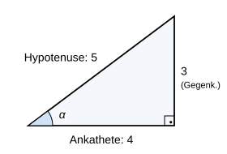

# Musterlösung: Mathematik-Schulaufgabe – Bayern 10. Klasse (Realschule)

> Die folgenden Lösungen zeigen den vollständigen Rechenweg. Andere, gleichwertige Lösungswege sind ebenfalls richtig. Kleine Abweichungen in der letzten Nachkommastelle, die durch gerundete Zwischenergebnisse entstehen, sind kein Fehler.

---

## Teil A – Ohne Hilfsmittel (12 BE)

### Aufgabe A1 – Winkel an Geradenkreuzungen (3 BE)

- $\alpha = 64°$, denn $\alpha$ ist **Scheitelwinkel** zum $64°$-Winkel. Beide liegen sich am oberen Schnittpunkt gegenüber.
- $\beta = 180° - 64° = 116°$, denn $\beta$ ist **Nebenwinkel** zum $64°$-Winkel. Nebenwinkel ergänzen sich zu $180°$.
- $\gamma = 64°$, denn $\gamma$ ist **Stufenwinkel** zum $64°$-Winkel an den parallelen Geraden $g$ und $h$.
  (Ebenfalls richtig: $\gamma$ ist **Wechselwinkel** zu $\alpha$, also $\gamma = \alpha = 64°$.)

Bewertung: je **1 BE** pro Winkel mit richtiger Begründung.

---

### Aufgabe A2 – Drachensteigen (2 BE)

Die Schnur ist die **Hypotenuse** ($50\,\text{m}$), die gesuchte Höhe $h$ ist die **Gegenkathete** zum $40°$-Winkel. Also braucht man den **Sinus**:

$$\sin 40° = \frac{h}{50\,\text{m}} \quad \Longrightarrow \quad h = 50\,\text{m} \cdot \sin 40° \approx 50\,\text{m} \cdot 0{,}64 = 32\,\text{m}$$

Der Drachen fliegt in etwa **32 m Höhe**.

*(Typischer Fehler: $\cos 40°$ oder $\sin 50°$ verwenden – beide liefern $0{,}77$ und damit das falsche Ergebnis $38{,}5\,\text{m}$.)*

---

### Aufgabe A3 – Rampe an der Turnhalle (2 BE)

Zuerst die Einheiten angleichen: $3\,\text{m} = 300\,\text{cm}$.

$$\text{Steigung} = \frac{\text{Höhenunterschied}}{\text{waagrechte Länge}} \cdot 100\,\% = \frac{21\,\text{cm}}{300\,\text{cm}} \cdot 100\,\% = \frac{7}{100} \cdot 100\,\% = 7\,\%$$

Da $7\,\% > 6\,\%$, ist die Rampe **nicht rollstuhlgerecht**.

---

### Aufgabe A4 – Skizze zu $\cos\alpha$ (2 BE)

$\cos\alpha = \dfrac{\text{Ankathete}}{\text{Hypotenuse}} = \dfrac{4}{5}$, also z. B. Ankathete $= 4$ und Hypotenuse $= 5$.

Die Gegenkathete erhält man mit dem Satz des Pythagoras:

$$\text{Gegenkathete} = \sqrt{5^2 - 4^2} = \sqrt{25 - 16} = \sqrt{9} = 3$$

$$\tan\alpha = \frac{\text{Gegenkathete}}{\text{Ankathete}} = \frac{3}{4}$$

Bewertung: **1 BE** für eine richtig beschriftete Skizze (rechter Winkel, $\alpha$ an der Ankathete $4$, Hypotenuse $5$), **1 BE** für $\tan\alpha = \frac{3}{4}$.
(Jede ähnliche Skizze, z. B. mit den Längen $8$, $6$ und $10$, ist ebenfalls richtig.)

---

### Aufgabe A5 – Gymnastikball (3 BE)

Radius: $r = \frac{40\,\text{cm}}{2} = 20\,\text{cm}$

$$V = \frac{4}{3} \cdot \pi \cdot r^3 = \frac{4}{3} \cdot 3 \cdot (20\,\text{cm})^3 = 4 \cdot 8\,000\,\text{cm}^3 = 32\,000\,\text{cm}^3$$

Umrechnen: $1\,\text{l} = 1\,\text{dm}^3 = 1\,000\,\text{cm}^3$

$$V = 32\,000\,\text{cm}^3 = 32\,\text{dm}^3 = 32\,\text{l}$$

Der Ball hat ein Volumen von etwa **32 Litern**.

Bewertung: **1 BE** Radius, **1 BE** Volumen in $\text{cm}^3$, **1 BE** Umrechnung in Liter.

---

## Teil B – Mit Taschenrechner und Formelsammlung (28 BE)

### Aufgabe B1 – Mit der Seilbahn auf den Hausberg (8 BE)

Skizze: rechtwinkliges Dreieck mit der Seillänge $s = 1{,}8\,\text{km} = 1\,800\,\text{m}$ als **Hypotenuse**, dem Höhenunterschied $h = 540\,\text{m}$ als **Gegenkathete** zu $\alpha$ und der waagrechten Entfernung $d$ als **Ankathete**.

#### a) Neigungswinkel [2 BE]

Einheiten angleichen: $1{,}8\,\text{km} = 1\,800\,\text{m}$.

$$\sin\alpha = \frac{h}{s} = \frac{540\,\text{m}}{1\,800\,\text{m}} = 0{,}3 \quad \Longrightarrow \quad \alpha = \sin^{-1}(0{,}3) \approx 17{,}46°$$

Der Neigungswinkel beträgt etwa **17,5°**.

#### b) Waagrechte Entfernung [2 BE]

$$\cos\alpha = \frac{d}{s} \quad \Longrightarrow \quad d = 1\,800\,\text{m} \cdot \cos 17{,}46° \approx 1\,800\,\text{m} \cdot 0{,}95393 \approx 1\,717{,}1\,\text{m}$$

Alternativ mit dem Satz des Pythagoras:

$$d = \sqrt{1\,800^2 - 540^2}\,\text{m} = \sqrt{2\,948\,400}\,\text{m} \approx 1\,717{,}1\,\text{m}$$

Die waagrechte Entfernung beträgt etwa **1 717 m** (≈ 1,72 km).

#### c) Steigung [2 BE]

$$\text{Steigung} = \frac{h}{d} \cdot 100\,\% = \frac{540\,\text{m}}{1\,717{,}1\,\text{m}} \cdot 100\,\% \approx 31{,}4\,\%$$

(Alternativ: $\tan 17{,}46° \approx 0{,}3145 \;\widehat{=}\; 31{,}4\,\%$)

Da $31{,}4\,\% > 30\,\%$, **stimmt die Angabe** auf dem Werbeplakat.

*(Typischer Fehler: $\frac{540}{1\,800} = 30\,\%$ rechnen. Bei der Steigung teilt man aber durch die **waagrechte** Entfernung, nicht durch die Seillänge!)*

#### d) Fahrzeit [2 BE]

Geschwindigkeit umrechnen:

$$18\,\frac{\text{km}}{\text{h}} = \frac{18\,000\,\text{m}}{3\,600\,\text{s}} = 5\,\frac{\text{m}}{\text{s}}$$

Fahrzeit (die Gondel fährt am Seil entlang, also $1\,800\,\text{m}$):

$$t = \frac{1\,800\,\text{m}}{5\,\frac{\text{m}}{\text{s}}} = 360\,\text{s} = 6\,\text{min}$$

Die Fahrt dauert **6 Minuten**.

(Alternativ: $t = \frac{1{,}8\,\text{km}}{18\,\frac{\text{km}}{\text{h}}} = 0{,}1\,\text{h} = 6\,\text{min}$)

---

### Aufgabe B2 – Segelregatta auf dem Chiemsee (10 BE)

#### a) Umrechnung [1 BE]

$$\overline{SA} = 1{,}2 \cdot 1{,}852\,\text{km} = 2{,}2224\,\text{km} \approx 2{,}22\,\text{km}$$

#### b) Länge von $\overline{AB}$ – Kosinussatz [3 BE]

Gegeben sind zwei Seiten und der eingeschlossene Winkel. Das Dreieck ist **nicht** rechtwinklig, also braucht man den **Kosinussatz**:

$$\overline{AB}^2 = \overline{SA}^2 + \overline{SB}^2 - 2 \cdot \overline{SA} \cdot \overline{SB} \cdot \cos 48°$$

$$\overline{AB}^2 = 2{,}2224^2 + 1{,}8^2 - 2 \cdot 2{,}2224 \cdot 1{,}8 \cdot \cos 48°$$

$$\overline{AB}^2 \approx 4{,}93906 + 3{,}24 - 8{,}00064 \cdot 0{,}66913 \approx 8{,}17906 - 5{,}35347 = 2{,}82559$$

$$\overline{AB} \approx \sqrt{2{,}82559}\,\text{km} \approx 1{,}68\,\text{km}$$

Bewertung: **1 BE** richtiger Ansatz (Kosinussatz), **1 BE** korrektes Einsetzen, **1 BE** Ergebnis.

#### c) Winkel bei $A$ – Sinussatz [3 BE]

Der Winkel bei $A$ liegt der Seite $\overline{SB} = 1{,}8\,\text{km}$ gegenüber, der Winkel $48°$ bei $S$ der Seite $\overline{AB} \approx 1{,}68\,\text{km}$.

$$\frac{\sin \sphericalangle SAB}{\overline{SB}} = \frac{\sin 48°}{\overline{AB}} \quad \Longrightarrow \quad \sin \sphericalangle SAB = \frac{1{,}8 \cdot \sin 48°}{1{,}68} \approx \frac{1{,}8 \cdot 0{,}74314}{1{,}68} \approx 0{,}79623$$

$$\sphericalangle SAB = \sin^{-1}(0{,}79623) \approx 52{,}8°$$

(Mit dem ungerundeten Wert $\overline{AB} \approx 1{,}6809\,\text{km}$ erhält man $52{,}7°$. Beide Ergebnisse sind richtig.)

*Hinweis:* Der gesuchte Winkel liegt **nicht** der längsten Seite ($\overline{SA} \approx 2{,}22\,\text{km}$) gegenüber und ist deshalb spitz. Das Ergebnis des Sinussatzes ist eindeutig.

Alternativ mit dem Kosinussatz:

$$\cos \sphericalangle SAB = \frac{\overline{SA}^2 + \overline{AB}^2 - \overline{SB}^2}{2 \cdot \overline{SA} \cdot \overline{AB}} \quad \Longrightarrow \quad \sphericalangle SAB \approx 52{,}7°$$

#### d) Winkel bei $B$ – Winkelsumme [1 BE]

$$\sphericalangle ABS = 180° - 48° - 52{,}8° = 79{,}2°$$

(Mit $52{,}7°$ aus Teilaufgabe c ergibt sich entsprechend $79{,}3°$.)

#### e) Flächeninhalt [2 BE]

Mit zwei Seiten und dem eingeschlossenen Winkel:

$$A = \frac{1}{2} \cdot \overline{SA} \cdot \overline{SB} \cdot \sin 48° = \frac{1}{2} \cdot 2{,}2224\,\text{km} \cdot 1{,}8\,\text{km} \cdot \sin 48° \approx 1{,}49\,\text{km}^2$$

Umrechnen in Hektar:

$$1{,}49\,\text{km}^2 = 1{,}49 \cdot 100\,\text{ha} = 149\,\text{ha}$$

Die gesperrte Wasserfläche ist etwa **1,49 km²** bzw. **149 ha** groß.

(Mit $\overline{SA} = 2{,}22\,\text{km}$ erhält man $1{,}48\,\text{km}^2 = 148\,\text{ha}$. Das ist ebenfalls richtig.)

---

### Aufgabe B3 – Eis in der Waffel (10 BE)

#### a) Radius und Höhe der Waffel [3 BE]

Die Höhe $h$ (Kegelachse) teilt den Öffnungswinkel in zwei Hälften. Es entsteht ein rechtwinkliges Dreieck mit

- der Mantellinie $s = 12\,\text{cm}$ als **Hypotenuse**,
- dem halben Öffnungswinkel $\frac{30°}{2} = 15°$ an der Spitze,
- dem Radius $r$ als **Gegenkathete** und der Höhe $h$ als **Ankathete** zu diesem Winkel.

$$r = 12\,\text{cm} \cdot \sin 15° \approx 12\,\text{cm} \cdot 0{,}25882 \approx 3{,}11\,\text{cm}$$

$$h = 12\,\text{cm} \cdot \cos 15° \approx 12\,\text{cm} \cdot 0{,}96593 \approx 11{,}59\,\text{cm}$$

Bewertung: **1 BE** halber Öffnungswinkel ($15°$), je **1 BE** für $r$ und $h$.
*(Typischer Fehler: mit $30°$ statt $15°$ rechnen.)*

#### b) Volumen des Eises [3 BE]

Eis in der Waffel (Kegel):

$$V_{\text{Kegel}} = \frac{1}{3} \cdot \pi \cdot r^2 \cdot h = \frac{1}{3} \cdot \pi \cdot (3{,}1058\,\text{cm})^2 \cdot 11{,}5911\,\text{cm} \approx 117{,}1\,\text{cm}^3$$

Eiskugel obendrauf (Halbkugel):

$$V_{\text{Halbkugel}} = \frac{1}{2} \cdot \frac{4}{3} \cdot \pi \cdot r^3 = \frac{2}{3} \cdot \pi \cdot (3{,}1058\,\text{cm})^3 \approx 62{,}7\,\text{cm}^3$$

Gesamtvolumen:

$$V = 117{,}1\,\text{cm}^3 + 62{,}7\,\text{cm}^3 \approx 179{,}8\,\text{cm}^3$$

(Mit den gerundeten Werten $r = 3{,}11\,\text{cm}$ und $h = 11{,}59\,\text{cm}$ erhält man $117{,}4\,\text{cm}^3 + 63{,}0\,\text{cm}^3 \approx 180{,}4\,\text{cm}^3$. Das ist ebenfalls richtig.)

Bewertung: je **1 BE** für Kegel und Halbkugel, **1 BE** für das Gesamtvolumen.

#### c) Anzahl der Waffeln [2 BE]

Umrechnen: $5\,\text{l} = 5\,\text{dm}^3 = 5\,000\,\text{cm}^3$

$$\frac{5\,000\,\text{cm}^3}{179{,}8\,\text{cm}^3} \approx 27{,}8$$

Da nur **vollständig** gefüllte Waffeln zählen, wird **abgerundet**: Mit dem Eis können **27 Waffeln** gefüllt werden.

(Mit $180{,}4\,\text{cm}^3$: $5\,000 : 180{,}4 \approx 27{,}7$, also ebenfalls 27 Waffeln.)

*(Typischer Fehler: auf 28 aufrunden. Für die 28. Waffel reicht das Eis aber nicht mehr.)*

#### d) XXL-Waffel [2 BE]

Lenas Aussage ist **falsch**.

Werden **alle Längen verdoppelt**, verdoppeln sich $r$ und $h$. Im Volumen werden drei Längen miteinander multipliziert ($r^2 \cdot h$ bzw. $r^3$), deshalb wird das Volumen mit $2 \cdot 2 \cdot 2 = 2^3 = 8$ multipliziert:

$$V_{\text{Kegel, XXL}} = \frac{1}{3} \cdot \pi \cdot (2r)^2 \cdot (2h) = 8 \cdot \frac{1}{3} \cdot \pi \cdot r^2 \cdot h, \qquad V_{\text{Halbkugel, XXL}} = \frac{2}{3} \cdot \pi \cdot (2r)^3 = 8 \cdot \frac{2}{3} \cdot \pi \cdot r^3$$

$$V_{\text{XXL}} = 8 \cdot 179{,}8\,\text{cm}^3 \approx 1\,438{,}7\,\text{cm}^3 \approx 1{,}44\,\text{l}$$

Für die XXL-Waffel braucht man also **achtmal** so viel Eis, nicht doppelt so viel.

Bewertung: **1 BE** für die Entscheidung „falsch“, **1 BE** für die Begründung (Faktor $2^3 = 8$ bzw. Rechnung).

---

## Bewertungsübersicht

| Aufgabe | Teilaufgabe | Inhalt | BE |
|---------|-------------|--------|----|
| A1 | – | Winkel an Geradenkreuzungen ($\alpha$, $\beta$, $\gamma$) | 3 |
| A2 | – | Drachenhöhe mit Tabellenwert ($\sin 40°$) | 2 |
| A3 | – | Steigung in Prozent (Rampe) | 2 |
| A4 | – | Skizze zu $\cos\alpha = \frac{4}{5}$, $\tan\alpha$ | 2 |
| A5 | – | Kugelvolumen mit $\pi = 3$, Umrechnung in Liter | 3 |
| **Teil A** | | | **12** |
| B1 | a) | Neigungswinkel (Sinus) | 2 |
| B1 | b) | Waagrechte Entfernung (Kosinus/Pythagoras) | 2 |
| B1 | c) | Steigung in Prozent | 2 |
| B1 | d) | Fahrzeit (km/h → m/s) | 2 |
| B2 | a) | Seemeilen → Kilometer | 1 |
| B2 | b) | Kosinussatz | 3 |
| B2 | c) | Sinussatz (Winkel) | 3 |
| B2 | d) | Winkelsumme | 1 |
| B2 | e) | Flächeninhalt, km² → ha | 2 |
| B3 | a) | Radius und Höhe (sin/cos im Kegel) | 3 |
| B3 | b) | Volumen Kegel + Halbkugel | 3 |
| B3 | c) | Liter → cm³, Anzahl der Waffeln | 2 |
| B3 | d) | Stellungnahme XXL-Waffel | 2 |
| **Teil B** | | | **28** |
| **Gesamt** | | | **40** |

### Notenschlüssel (Vorschlag)

| BE | Note |
|:--:|:----:|
| 40 – 34 | 1 |
| 33 – 29 | 2 |
| 28 – 22 | 3 |
| 21 – 16 | 4 |
| 15 – 8 | 5 |
| 7 – 0 | 6 |
