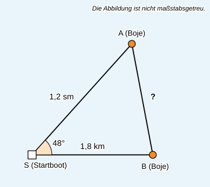

# Mathematik-Schulaufgabe – Bayern 10. Klasse (Realschule)

**Thema:** Trigonometrie (sin, cos, tan, Sinussatz, Kosinussatz), Winkel an Geradenkreuzungen, Kugel und zusammengesetzte Körper, Umrechnen von Einheiten  
**Bearbeitungszeit:** 45 Minuten (Teil A: ca. 12 Minuten, Teil B: ca. 33 Minuten)  
**Hilfsmittel:** Teil A: keine (kein Taschenrechner, keine Formelsammlung) | Teil B: Taschenrechner, Formelsammlung  
**Gesamtpunktzahl:** 40 BE (Teil A: 12 BE, Teil B: 28 BE)  
**Datum:** ..................  **Name:** ..................

---

> 📝 **Tipps von eurer Lehrkraft:**
> - Ihr bekommt zuerst **Teil A**. Den gebt ihr ab, bevor ihr Taschenrechner und Formelsammlung herausholt und mit **Teil B** weitermacht.
> - Lest euch alle Aufgaben in Ruhe durch und **markiert in jeder Skizze, was gegeben und was gesucht ist**.
> - Rechtwinkliges Dreieck? → sin, cos, tan oder Pythagoras. **Kein** rechter Winkel? → Sinussatz oder Kosinussatz.
> - Achtet auf die **Einheiten**! Rechnet vorher alles in dieselbe Einheit um (z. B. km → m, cm³ → Liter).
> - Stellt den Taschenrechner auf **DEG** (Gradmaß) und rundet erst am Schluss.
> - Schreibt eure Rechenwege vollständig auf – Ergebnisse ohne Rechenweg werden nicht gewertet!
>
> Viel Erfolg! 🍀

---

## Teil A – Ohne Hilfsmittel (12 BE)

### Aufgabe A1 – Winkel an Geradenkreuzungen (3 BE)

Die Geraden $g$ und $h$ sind **parallel** ($g \parallel h$).

Bestimme die Winkel $\alpha$, $\beta$ und $\gamma$. Gib jeweils an, welche Winkelbeziehung (Nebenwinkel, Scheitelwinkel, Stufenwinkel oder Wechselwinkel) du verwendet hast. [3 BE]

---

### Aufgabe A2 – Drachensteigen (2 BE)

Lukas lässt auf der Wiese hinter der Schule einen Drachen steigen. Die Drachenschnur ist $50\,\text{m}$ lang, straff gespannt und bildet mit dem Boden einen Winkel von $40°$.

| Winkel | $40°$ | $50°$ |
|:------:|:-----:|:-----:|
| $\sin$ | $0{,}64$ | $0{,}77$ |
| $\cos$ | $0{,}77$ | $0{,}64$ |
| $\tan$ | $0{,}84$ | $1{,}19$ |

*Die Werte in der Tabelle sind auf zwei Stellen gerundet.*

Berechne mithilfe der Tabelle, in welcher Höhe $h$ der Drachen fliegt. (Die Körpergröße von Lukas wird vernachlässigt.) [2 BE]

---

### Aufgabe A3 – Rampe an der Turnhalle (2 BE)

Für eine **rollstuhlgerechte** Rampe gilt: Die Steigung darf **höchstens 6 %** betragen.

Die neue Rampe am Eingang der Turnhalle überwindet einen Höhenunterschied von $21\,\text{cm}$ auf einer waagrechten Länge von $3\,\text{m}$.

Überprüfe rechnerisch, ob die Rampe rollstuhlgerecht ist. [2 BE]

---

### Aufgabe A4 – Skizze zu $\cos\alpha$ (2 BE)

In einem rechtwinkligen Dreieck gilt für den Winkel $\alpha$:

$$\cos\alpha = \frac{4}{5}$$

Fertige eine passende Skizze des Dreiecks an, beschrifte die Seiten mit ihren Längen und gib $\tan\alpha$ als Bruch an. [2 BE]

---

### Aufgabe A5 – Gymnastikball (3 BE)

Ein Gymnastikball aus dem Sportunterricht hat einen **Durchmesser** von $40\,\text{cm}$.

Berechne das Volumen des Balls mit $\pi = 3$ und gib das Ergebnis in **Litern** an.

*Formel:* $V_{\text{Kugel}} = \frac{4}{3} \cdot \pi \cdot r^3$ [3 BE]

---

> ✋ **Ende von Teil A** – bitte abgeben. Jetzt dürft ihr Taschenrechner und Formelsammlung benutzen.

---

## Teil B – Mit Taschenrechner und Formelsammlung (28 BE)

### Aufgabe B1 – Mit der Seilbahn auf den Hausberg (8 BE)

Familie Huber fährt in den Pfingstferien mit der Seilbahn auf den Hausberg. Auf der Infotafel an der Talstation steht:

> **Seillänge (Talstation → Bergstation):** 1,8 km  
> **Höhenunterschied:** 540 m

Nimm vereinfachend an, dass das Seil geradlinig verläuft.

*Tipp: Fertige dir zuerst eine beschriftete Skizze an.*

**a)** Berechne den Neigungswinkel $\alpha$ der Seilbahn. [2 BE]

**b)** Berechne die waagrechte Entfernung $d$ zwischen Tal- und Bergstation. [2 BE]

**c)** Auf einem Werbeplakat steht: *„Mit über 30 % Steigung eine der steilsten Bahnen der Region!“*
Überprüfe rechnerisch, ob diese Angabe stimmt. [2 BE]

**d)** Die Gondel fährt mit einer Geschwindigkeit von $18\,\frac{\text{km}}{\text{h}}$. Berechne, wie viele Minuten die Fahrt von der Tal- zur Bergstation dauert. [2 BE]

---

### Aufgabe B2 – Segelregatta auf dem Chiemsee (10 BE)

Beim Segelcamp am Chiemsee wird eine Regatta auf einem Dreieckskurs gesegelt: vom Startboot $S$ zur Boje $A$, weiter zur Boje $B$ und zurück zum Startboot. Die Regattaleitung gibt folgende Daten an:

- $\overline{SA} = 1{,}2\,\text{sm}$ (Seemeilen; $1\,\text{sm} = 1{,}852\,\text{km}$)
- $\overline{SB} = 1{,}8\,\text{km}$
- $\sphericalangle ASB = 48°$

**a)** Rechne die Länge der Strecke $\overline{SA}$ in Kilometer um. [1 BE]

**b)** Berechne die Länge der Strecke $\overline{AB}$. Runde auf zwei Nachkommastellen. [3 BE]
(Zwischenergebnis: $\overline{AB} \approx 1{,}68\,\text{km}$)

**c)** Berechne das Maß des Winkels $\sphericalangle SAB$ (Winkel bei der Boje $A$). [3 BE]

**d)** Berechne das Maß des Winkels $\sphericalangle ABS$ (Winkel bei der Boje $B$). [1 BE]

**e)** Während der Regatta ist die Wasserfläche innerhalb des Kurses für andere Boote gesperrt. Berechne den Flächeninhalt des Dreiecks $SAB$ in $\text{km}^2$ und gib ihn auch in Hektar an ($1\,\text{km}^2 = 100\,\text{ha}$). [2 BE]

---

### Aufgabe B3 – Eis in der Waffel (10 BE)

Die Eisdiele „Dolce Vita“ verkauft Eis in spitzen Waffeln. Eine Waffel hat die Form eines **Kegels** mit der Mantellinie $s = 12\,\text{cm}$ und einem Öffnungswinkel von $30°$. Die Waffel ist bis zum Rand mit Eis gefüllt. Obendrauf sitzt eine Eiskugel, die genau eine **Halbkugel** mit dem Radius $r$ der Waffelöffnung bildet.

**a)** Berechne den Radius $r$ und die Höhe $h$ der Waffel. [3 BE]
(Zwischenergebnis: $r \approx 3{,}11\,\text{cm}$; $h \approx 11{,}59\,\text{cm}$)

**b)** Berechne das Volumen des gesamten Eises (Eis in der Waffel und Halbkugel obendrauf) in $\text{cm}^3$. [3 BE]

**c)** Ein Eisbehälter in der Theke enthält noch $5$ Liter Eis. Berechne, wie viele Waffeln damit **vollständig** gefüllt werden können. [2 BE]

**d)** Für den Sommer plant die Eisdiele eine „XXL-Waffel“, bei der **alle Längen** (Mantellinie, Radius, Höhe) **doppelt so groß** sind. Lena meint: *„Dann braucht man für die XXL-Waffel doppelt so viel Eis.“*
Nimm begründet Stellung zu Lenas Aussage. [2 BE]

---

**Viel Erfolg bei der Bearbeitung! 🍀**  
Denkt daran: Erst Skizze, dann gegeben/gesucht markieren, dann rechnen. Ihr schafft das! 😊
